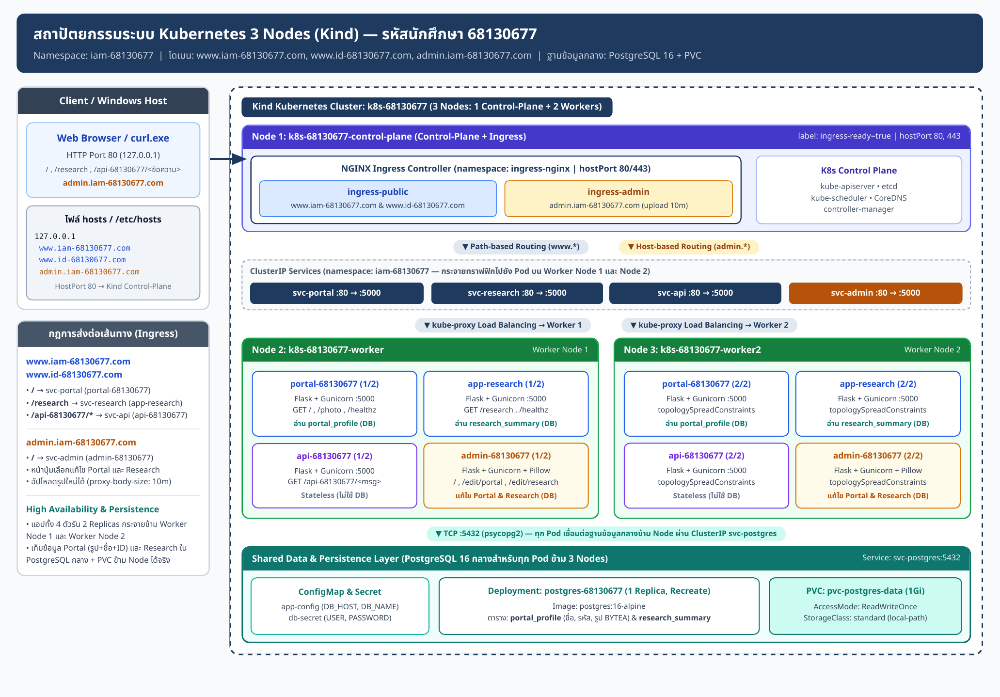

# Kubernetes 3-Node Multi-Service Architecture (ID: 68130677)

โปรเจกต์การออกแบบและให้บริการเว็บแอปพลิเคชันแบบไมโครเซอร์วิสบนคลัสเตอร์ **Kubernetes จำนวน 3 Nodes (1 Control-Plane + 2 Worker Nodes)** ด้วย Kind พร้อมฐานข้อมูลกลาง PostgreSQL 16 (+PVC) รองรับการติดตั้งแบบคำสั่งเดียวจบทั้งบน **Windows** และ **Linux Ubuntu**

- **นักศึกษา:** นายธรรมฤทธิ์ ธนอนันต์
- **รหัสนักศึกษา:** 68130677
- **รองรับ OS:** Windows (Docker Desktop) และ Linux Ubuntu 20.04 / 22.04 / 24.04 (Docker Engine)
- **Stack:** Kubernetes (Kind 3 Nodes), NGINX Ingress Controller, Python 3.12 (Flask + Gunicorn + Pillow), PostgreSQL 16

## สถาปัตยกรรมระบบ (System Architecture)



## รายการบริการและเส้นทางเข้าถึง (Services & Routing)

| URL | Kubernetes Service | Deployment (Replicas) | หน้าที่การทำงาน |
|---|---|---|---|
| `http://www.iam-68130677.com`<br>`http://www.id-68130677.com` | `svc-portal` | `portal-68130677` (2) | แสดงรูปภาพ ชื่อ และรหัสนักศึกษา (อ่านจาก PostgreSQL กลาง) |
| `http://www.iam-68130677.com/research`<br>`http://www.id-68130677.com/research` | `svc-research` | `app-research` (2) | แสดงสรุปงานวิจัยวิชาสัมมนา 300–500 คำ (อ่านจาก PostgreSQL กลาง) |
| `http://www.iam-68130677.com/api-68130677/<ข้อความ>` | `svc-api` | `api-68130677` (2) | แสดง `<ข้อความ>` ขนาดใหญ่กลางหน้าจอ เช่น `/api-68130677/Hello` |
| `http://admin.iam-68130677.com` | `svc-admin` | `admin-68130677` (2) | หน้า Dashboard มีปุ่มเลือกแก้ไขข้อมูล **Portal** (ชื่อ, รหัส, อัปโหลดรูป) และ **Research** (หัวข้อ, เนื้อหา) |
| *(Internal)* `svc-postgres:5432` | `svc-postgres` | `postgres-68130677` (1 + PVC 1Gi) | ฐานข้อมูลกลางเก็บตาราง `portal_profile` และ `research_summary` ข้าม 3 โหนด |

## ติดตั้งและตรวจสอบทั้งหมดด้วยคำสั่งเดียว (One-Command Setup)

### 1) สำหรับ Windows (Docker Desktop)
เปิด **Docker Desktop** ให้ทำงาน จากนั้นเปิด Command Prompt หรือ PowerShell ในโฟลเดอร์โปรเจกต์แล้วรันคำสั่งเดียว:
```cmd
setup-all.bat
```
*(ใน PowerShell พิมพ์ `.\setup-all.bat` | รันตรวจสอบซ้ำ: `verify.bat` | ลบคลัสเตอร์: `cleanup.bat`)*

### 2) สำหรับ Linux Ubuntu (Docker Engine)
ตรวจสอบว่าติดตั้ง Docker และผู้ใช้ปัจจุบันอยู่ในกลุ่ม `docker` แล้ว (`docker info` ทำงานได้โดยไม่ติด permission) จากนั้นรันคำสั่งเดียว:
```bash
chmod +x setup-all.sh deploy.sh verify.sh cleanup.sh && ./setup-all.sh
```
*(รันตรวจสอบซ้ำ: `./verify.sh` | ลบคลัสเตอร์: `./cleanup.sh`)*

### สิ่งที่สคริปต์จัดการให้อัตโนมัติทั้ง Windows และ Linux Ubuntu
1. ตรวจสอบ `docker` และดาวน์โหลด `kind` (`v0.24.0`) ลง `./bin/` ให้อัตโนมัติหากยังไม่มี (บน Ubuntu จะดาวน์โหลด `kubectl` และปรับค่า `fs.inotify` ของเคอร์เนลสำหรับคลัสเตอร์ 3 โหนดให้อัตโนมัติด้วย)
2. เพิ่มโดเมน `www.iam-68130677.com`, `www.id-68130677.com`, `admin.iam-68130677.com` ลงในไฟล์ `hosts` (Windows) หรือ `/etc/hosts` (Ubuntu) แบบไม่เขียนซ้ำ
3. สร้างคลัสเตอร์ **Kind 3 Nodes** (`k8s-68130677`: 1 Control-Plane + 2 Workers) จาก `kind-config.yaml` และรอจนทั้ง 3 โหนดพร้อมใช้งาน
4. Build local Docker images ทั้ง 4 บริการ ดึง `postgres:16-alpine` และโหลดทั้งหมดเข้าคลัสเตอร์ Kind
5. ติดตั้ง NGINX Ingress Controller (Kind Provider) และ Apply Manifests ทั้งหมดใน `k8s/` พร้อมระบบ Retry Admission Webhook และ Rollout Restart อัตโนมัติเมื่อรันซ้ำ
6. ตรวจสอบจำนวน 3 โหนด, การกระจาย Pod ข้าม Worker 1–2 และยิงทดสอบ HTTP ครบทั้ง 10 กรณี พร้อมบันทึกหลักฐานลง `verification-log.txt`

## โครงสร้างโปรเจกต์

```text
k8s-3node-68130677/
├── apps/
│   ├── portal-68130677/          # หน้าแสดงรูป ชื่อ รหัสนักศึกษา
│   ├── app-research/             # หน้าแสดงสรุปงานวิจัย 300–500 คำ
│   ├── api-68130677/             # หน้าแสดงข้อความตัวใหญ่กลางจอ
│   └── admin-68130677/           # หน้า Dashboard + ฟอร์มแก้ Portal (รวมอัปโหลดรูป) & Research
├── k8s/
│   ├── 00-namespace.yaml         # Namespace: iam-68130677
│   ├── 01-config-secret.yaml     # ConfigMap & Secret สำหรับฐานข้อมูล
│   ├── 02-postgres.yaml          # PVC (1Gi) + Deployment postgres-68130677 + Service
│   ├── 03-portal.yaml            # Deployment portal-68130677 (2 Replicas) + Service
│   ├── 04-research.yaml          # Deployment app-research (2 Replicas) + Service
│   ├── 05-api.yaml               # Deployment api-68130677 (2 Replicas) + Service
│   ├── 06-admin.yaml             # Deployment admin-68130677 (2 Replicas) + Service
│   └── 07-ingress.yaml           # ingress-public (www.iam & www.id) + ingress-admin
├── config/
│   └── hosts.example             # ตัวอย่างไฟล์ hosts / /etc/hosts
├── docs/
│   ├── architecture-diagram.png
│   ├── 01-deployment-report-68130677.pdf
│   ├── 01-deployment-report-68130677.docx
│   ├── 03-test-verification-68130677.pdf
│   └── 03-test-verification-68130677.docx
├── kind-config.yaml              # คอนฟิกสร้าง Kind คลัสเตอร์ 3 Nodes
├── setup-all.bat / setup-all.ps1 # สคริปต์รันครั้งเดียวจบสำหรับ Windows
├── deploy.bat / verify.bat / cleanup.bat
├── setup-all.sh                  # สคริปต์รันครั้งเดียวจบสำหรับ Linux Ubuntu / macOS
├── deploy.sh / verify.sh / cleanup.sh
├── .gitattributes                # บังคับ LF สำหรับ .sh และ CRLF สำหรับ .bat/.ps1
├── .gitignore
└── README.md
```
